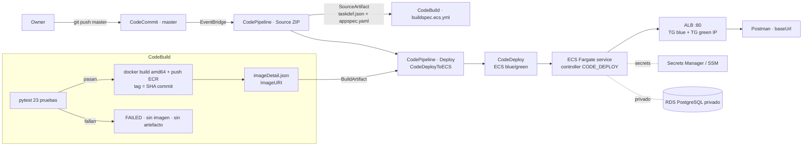

# Diseño — Entrega 3: Entrega Continua (CD)

Microservicio de lista negra de emails · Grupo Blue Team

## 1. Visión general

La Entrega 3 convierte la CI de la Entrega 2 en un flujo completo de CI/CD sobre AWS,
usando contenedores en lugar de Elastic Beanstalk:

- **Fuente:** AWS CodeCommit, rama `master`.
- **CI:** AWS CodeBuild ejecuta las pruebas unitarias existentes; si pasan, construye y
  publica la imagen Docker en Amazon ECR y emite `imageDetail.json`.
- **CD:** AWS CodeDeploy (plataforma ECS, blue/green) despliega la imagen al servicio
  ECS Fargate, orquestado por AWS CodePipeline, sin aprobación manual.

GitHub `main` sigue siendo la rama de integración del equipo. La relación GitHub ↔ CodeCommit
y la forma exacta de publicar la revisión aprobada se definen tras la verificación read-only
del operador (ver sección 9, elementos pendientes).

## 2. Arquitectura

## 3. Mapeo source → imagen → artefactos → entorno → rollback

### 3.1 Revisión de origen

- CodeCommit `master`. El commit resuelto (`CODEBUILD_RESOLVED_SOURCE_VERSION`) determina el
  tag de la imagen. Cada ejecución registra su SHA.
- Artefacto de origen en formato ZIP (`CODE_ZIP`), porque la acción Deploy consume
  `taskdef.json` y `appspec.yaml` directamente del artefacto de origen.

### 3.2 Imagen

- CodeBuild construye con `docker build` para `linux/amd64` (coincide con la task definition
  Fargate x86_64) y publica a ECR con tag = SHA corto del commit. Nunca se usa `latest` como
  entrada de despliegue.
- Se registra el digest publicado. En reintentos, el mismo tag reutiliza la imagen ya
  publicada de forma segura; un tag en conflicto falla de forma clara.

### 3.3 Artefactos y contrato CodeDeployToECS

La acción `CodeDeployToECS` (confirmada con la documentación de AWS):

- Busca `taskdef.json` y `appspec.yaml` en el **artefacto de origen** (`TaskDefinitionTemplateArtifact`,
  `AppSpecTemplateArtifact` = SourceArtifact).
- Busca `imageDetail.json` (con `ImageURI`) en el **artefacto de imagen** (`Image1ArtifactName` = BuildArtifact).
- Reemplaza en el taskdef el placeholder `<IMAGE1_NAME>` por el `ImageURI`, mapeado vía
  `Image1ContainerName = IMAGE1_NAME`.
- Reemplaza en el appspec `TaskDefinition: <TASK_DEFINITION>` por el ARN de la nueva revisión.

Alineación obligatoria (verificada por `scripts/validate_deploy_artifacts.py`):

| Elemento | Valor |
|---|---|
| Nombre del contenedor | `blacklist` (igual en taskdef, appspec y servicio ECS) |
| Puerto del contenedor | `8000` (igual en taskdef, appspec, Dockerfile EXPOSE y TG) |
| Placeholder de imagen | `<IMAGE1_NAME>` en el campo `image` del taskdef |
| `Image1ContainerName` | `IMAGE1_NAME` |
| AppSpec TaskDefinition | `<TASK_DEFINITION>` |

### 3.4 Entorno

- Red `awsvpc`, reutilizando VPC/subnets del lab Academy (IDs parametrizados).
- ALB público, listener de producción :80, **dos target groups IP** (blue/green) para CodeDeploy.
- SG de tasks restringido al tráfico del ALB; PostgreSQL privado.
- Variables no sensibles (`DB_HOST`, `DB_PORT`, `DB_NAME`) como `environment`; valores
  sensibles (`DB_USER`, `DB_PASSWORD`, `JWT_SECRET_KEY`) como `secrets` (Secrets Manager / SSM).
- Rol de ejecución de la task (pull de ECR + lectura de secretos + logs) y rol de la task
  (acceso a dependencias) como parámetros.
- Egress de subnets verificado para pull de ECR y alcance a los servicios AWS y a RDS.

### 3.5 Rollback

- Controlador de despliegue del servicio: `CODE_DEPLOY`.
- CodeDeploy con rollback automático en fallo de despliegue (cuando los permisos lo permitan).
- El target previo (blue) se mantiene disponible hasta verificar el cutover a la nueva
  revisión (green).

## 4. CI — `buildspec.ecs.yml`

Fases:

1. `install`: Python 3.12 + uv (versión fijada) + `uv sync --frozen --dev`.
2. `pre_build`: diagnósticos, `uv lock --locked`, login a ECR.
3. `build`: `uv run pytest` (JUnit XML). Si falla, CodeBuild marca el build FAILED.
4. `post_build`: solo si `CODEBUILD_BUILD_SUCCEEDING = 1`, `docker build` (amd64),
   `docker push` con tag = SHA, y escribe `imageDetail.json` con el `ImageURI`.

El gate garantiza que una versión con pruebas rotas nunca publique imagen ni produzca
artefacto desplegable. El `buildspec.yml` de la Entrega 2 (Elastic Beanstalk) se conserva
sin cambios; el proyecto CodeBuild de la Entrega 3 se configura para usar `buildspec.ecs.yml`.

Se requiere modo privilegiado en CodeBuild (para `docker build`) y permisos de ECR
(login, push) en el rol de servicio del proyecto.

## 5. Artefactos de despliegue en el repositorio

- `deploy/taskdef.json`: task definition Fargate parametrizada (placeholders `__ACCOUNT_ID__`,
  `__REGION__`, roles, secretos, `DB_HOST`), `requiresCompatibilities: [FARGATE]`,
  `networkMode: awsvpc`, `cpu/memory` Fargate-compatibles, `runtimePlatform` x86_64,
  contenedor `blacklist` puerto 8000, `image: <IMAGE1_NAME>`, logs a CloudWatch.
- `deploy/appspec.yaml`: `version: 0.0`, `Resources[].TargetService` con
  `TaskDefinition: <TASK_DEFINITION>`, `LoadBalancerInfo.ContainerName: blacklist`,
  `ContainerPort: 8000`. Sección `Hooks` opcional para el escenario CD FAIL.
- `scripts/validate_deploy_artifacts.py`: valida coherencia de nombre de contenedor/puerto
  y presencia de placeholders.

## 6. Baseline manual Fargate

Documentado en `deploy/create-fargate-baseline.md` con comandos PowerShell y bash:
bootstrap de la primera imagen en ECR, cluster Fargate, ALB + 2 TG IP + listener :80,
servicio con controlador `CODE_DEPLOY`, SG, secretos, verificación de egress, y checklist de
verificación (task RUNNING, target healthy, Postman OK).

## 7. Escenario CD FAIL — dos rutas

- **Ruta A (preferida): hook de validación CodeDeploy.** Lambda asociada a un lifecycle event
  (`AfterAllowTestTraffic`) que reporta `Failed` antes de mover tráfico de producción.
  Requiere permisos de Lambda y callback `codedeploy:PutLifecycleEventHookExecutionStatus`.
- **Ruta B (alternativa): override de task definition.** Cambio de despliegue que hace fallar
  el health check solo del task de reemplazo (p. ej. health check apuntando a una ruta/puerto
  inexistente), manteniendo el task set actual sano. Determinista respecto a la imagen real.

Se implementa solo la ruta aprobada según permisos de Academy; ambas quedan preparadas en
`deploy/cd-fail/` como parches reversibles fuera del working tree normal.

## 8. Pruebas y verificación local

- `pytest` (23 pruebas) con SQLite en memoria.
- `docker build` local (amd64) + `docker run` con variables mínimas para verificar `/health`.
- `scripts/validate_deploy_artifacts.py` para coherencia de artefactos de despliegue.
- Colección Postman con `baseUrl` y casos health + negocio.

## 9. Elementos pendientes (verificación read-only del operador en AWS)

| Elemento | Estado | Acción del operador |
|---|---|---|
| Cuenta, región, permisos Academy | Pendiente | `aws sts get-caller-identity`, confirmar región |
| CodeCommit repo + rama `master` + historial | Pendiente | `aws codecommit get-repository`, `list-branches` |
| Relación GitHub ↔ CodeCommit | Pendiente | Decidir espejo/push de la revisión aprobada |
| CodeBuild/CodePipeline existentes reutilizables | Pendiente | `aws codebuild list-projects`, `codepipeline list-pipelines` |
| Roles IAM + trust + `iam:PassRole` | Pendiente | Revisar roles de ejecución/tarea/servicio |
| RDS `blacklist-db` vivo y alcanzable | Pendiente | `aws rds describe-db-instances`, revisar SG/subnets |
| VPC/subnets/ALB/TG/listener | Pendiente | `aws ec2 describe-subnets`, `elbv2 describe-*` |
| ECR repo | Pendiente | `aws ecr describe-repositories` o crear |
| Permisos de Lambda (ruta A del CD FAIL) | Pendiente | Confirmar para elegir ruta A o B |

Todos los cambios de AWS esperan la aprobación explícita del owner.
