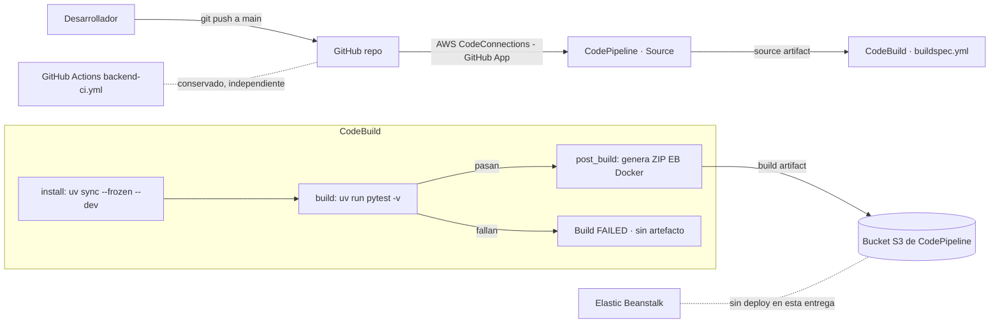

# Proyecto 1 · Entrega 2 - Integración Continua (CI)

**Microservicio de lista negra de emails · Grupo Blue Team**
Curso MISW-4302 DevOps: Agilizando el Despliegue Continuo de Aplicaciones · Universidad de los Andes

> Este archivo es la **documentación técnica completa** de la entrega (arquitectura, pasos de consola, runbooks).
> El entregable `Proyecto 1 entrega 2 – Documento.pdf` es un documento **conciso aparte**, centrado en las dos ejecuciones de CodePipeline (exitosa y fallida) con capturas reales; ver [`documento-pdf.md`](documento-pdf.md).
> Las secciones marcadas con **`EVIDENCIA AWS PENDIENTE`** requieren capturas reales de la consola de AWS y **no deben completarse con material inventado**.

---

## 0. Nota de cumplimiento: `master` (enunciado) vs `main` (repositorio)

El enunciado del curso se refiere a la rama principal como **`master`**. **En este repositorio la rama principal real es `main`** (verificado en `origin`). El flujo de ramas del equipo es `feature/* → develop → main`, y así lo automatiza el workflow de GitHub Actions `backend-ci.yml`, cuyo destino final de promoción es **`main`** (no `master`).

**`master` y `main` NO son alias en Git.** Son dos referencias (refs) independientes: `refs/heads/master` y `refs/heads/main`. Git no las sincroniza automáticamente; si ambas existieran, apuntarían a commits distintos salvo que se igualen de forma explícita (p. ej. creando una desde la otra o con un push dirigido). Por eso esta diferencia de nombre es real y **no** debe asumirse resuelta por Git.

**Decisión adoptada:** la CI de AWS usa **`main` como rama fuente del CodePipeline**, porque `main` es la rama principal real y la que recibe los cambios integrados. `main` cumple el rol que el enunciado llama "master". **No se crea una rama `master` duplicada**, para no mantener dos líneas principales divergentes.

**Riesgo de cumplimiento a validar con el evaluador:** si la rúbrica exige **literalmente** una rama llamada `master`, hay que señalar que aquí ese rol lo cumple `main`. Mitigación de menor impacto si el evaluador es estricto con el nombre: publicar `master` como **espejo de `main`** (creada desde el mismo commit) y apuntar el trigger del CodePipeline a `master`; esto se evita por defecto porque duplica la rama principal. Esta decisión queda pendiente de tu confirmación.

---

## Tabla de contenido

- [Proyecto 1 · Entrega 2 - Integración Continua (CI)](#proyecto-1--entrega-2--integración-continua-ci)
  - [0. Nota de cumplimiento: `master` (enunciado) vs `main` (repositorio)](#0-nota-de-cumplimiento-master-enunciado-vs-main-repositorio)
  - [Tabla de contenido](#tabla-de-contenido)
  - [1. Objetivo de la entrega](#1-objetivo-de-la-entrega)
  - [2. Alcance (solo CI)](#2-alcance-solo-ci)
    - [2.1 Relación con el workflow de GitHub Actions existente](#21-relación-con-el-workflow-de-github-actions-existente)
  - [3. Arquitectura de Integración Continua](#3-arquitectura-de-integración-continua)
  - [4. Pruebas unitarias del API](#4-pruebas-unitarias-del-api)
    - [4.1 Checklist endpoint → prueba](#41-checklist-endpoint--prueba)
    - [4.2 Ejecución local de las pruebas](#42-ejecución-local-de-las-pruebas)
  - [5. Proceso de build y artefacto (AWS CodeBuild)](#5-proceso-de-build-y-artefacto-aws-codebuild)
    - [5.1 buildspec.yml](#51-buildspecyml)
    - [5.2 Empaquetado del artefacto](#52-empaquetado-del-artefacto)
  - [6. Configuración en la consola de AWS](#6-configuración-en-la-consola-de-aws)
    - [6.1 Conexión a GitHub (AWS CodeConnections / GitHub App)](#61-conexión-a-github-aws-codeconnections--github-app)
    - [6.2 Proyecto de CodeBuild](#62-proyecto-de-codebuild)
    - [6.3 Pipeline de CodePipeline](#63-pipeline-de-codepipeline)
    - [6.4 Roles y permisos mínimos](#64-roles-y-permisos-mínimos)
  - [7. Evidencia de ejecución exitosa](#7-evidencia-de-ejecución-exitosa)
  - [8. Evidencia de ejecución fallida](#8-evidencia-de-ejecución-fallida)
  - [9. Elastic Beanstalk y Postman](#9-elastic-beanstalk-y-postman)
  - [10. Notas del entorno local](#10-notas-del-entorno-local)
  - [11. Checklist de lo que falta (acciones manuales)](#11-checklist-de-lo-que-falta-acciones-manuales)

---

## 1. Objetivo de la entrega

Incorporar **Integración Continua** al microservicio de la entrega 1, de modo que cada cambio integrado a la rama principal (`main`) dispare automáticamente una canalización en AWS que:

1. Obtenga el código fuente desde GitHub.
2. Instale dependencias y ejecute las **pruebas unitarias** del API.
3. Genere un **artefacto desplegable** (ZIP para la plataforma Docker de Elastic Beanstalk) **solo si las pruebas pasan**.
4. Conserve ese artefacto en el almacén S3 de la canalización.

Esta entrega es **únicamente CI**: no incluye una etapa de despliegue automático a Elastic Beanstalk (no hay CD).

## 2. Alcance (solo CI)

| Incluido en esta entrega | No incluido |
|---|---|
| Pruebas unitarias por endpoint | Despliegue automático a Elastic Beanstalk |
| `buildspec.yml` para AWS CodeBuild | Entrega continua (CD) |
| Pipeline en AWS CodePipeline disparado por push a `main` | Promoción automática de ramas en AWS |
| Artefacto ZIP retenido en S3 | Cambios a producción o a datos existentes |

El flujo de GitHub Actions existente (`.github/workflows/backend-ci.yml`) se **conserva sin cambios**; la CI de AWS es independiente y usa `main` como fuente.

### 2.1 Relación con el workflow de GitHub Actions existente

El repositorio ya tiene `.github/workflows/backend-ci.yml`. **Se conserva intacto y NO se duplica.** Son dos mecanismos con roles distintos:

| Aspecto | GitHub Actions `backend-ci.yml` (existente) | AWS CodePipeline + CodeBuild (esta entrega) |
|---|---|---|
| Rol | Verificación y **promoción de ramas** del equipo | **CI requerida de la entrega 2** |
| Disparo | Push con mensaje que empieza por `MERGE:` en `feature/**`, `develop`, `release/**`, `main`, `master` | Push a `main` vía CodeConnections |
| Qué hace | `uv sync`, `pytest -v`, `compileall`, cobertura; y promueve `feature → develop → release/<ts> → main` | Corre `pytest` y, solo si pasa, genera el **ZIP EB Docker** y lo retiene en S3 |
| Artefacto | `coverage.xml` (artifact de Actions) | ZIP desplegable (artifact store de CodePipeline) |
| Evidencia de la entrega | No | **Sí**: corrida exitosa y fallida salen de aquí |
| Deploy | No | No (CI only) |

La evidencia exigida (ejecución exitosa y fallida) se obtiene **exclusivamente de AWS CodePipeline**; GitHub Actions no sustituye ese requisito.

## 3. Arquitectura de Integración Continua



**Decisiones de diseño:**

- **Origen:** GitHub mediante **AWS CodeConnections** (GitHub App), método recomendado por AWS frente al webhook/OAuth clásico (v1).
- **Disparador:** push a la rama `main` (rama principal; ver [Nota de cumplimiento](#0-nota-de-cumplimiento-sobre-la-rama-master)).
- **Artefacto:** ZIP del código fuente versionado, en el formato que ya consume Elastic Beanstalk con plataforma Docker (mismo contenido que el `git archive` de la entrega 1).
- **Aislamiento de pruebas:** las pruebas usan SQLite en memoria y un secreto JWT fijo de prueba, así que el build **no depende de una base de datos en vivo** ni de secretos.

## 4. Pruebas unitarias del API

### 4.1 Checklist endpoint → prueba

| Endpoint | Método | Autenticación | Casos de éxito | Casos de error | Archivo de prueba |
|---|---|---|---|---|---|
| `/health` | GET | No requiere | `200 {"status":"ok"}` | - | `tests/test_health.py` |
| `/blacklists` | POST | Bearer JWT | `201` creado · persistencia de campos del servidor · sin `blocked_reason` · IP tomada de `X-Forwarded-For` | `409` duplicado · `400` campo faltante (`email`, `app_uuid`) · `400` formato inválido (`email`, `app_uuid`) · `400` `blocked_reason` > 255 · `400` campo desconocido · `400` body no-JSON · `401` token ausente/inválido | `tests/test_blacklist_create.py` |
| `/blacklists/<email>` | GET | Bearer JWT | `200` bloqueado (con motivo) · `200` no bloqueado · normalización de mayúsculas | `400` email vacío · `400` formato inválido · `401` token ausente/inválido | `tests/test_blacklist_query.py` |

Total: **23 pruebas**. Cada endpoint tiene al menos un escenario significativo de éxito y los casos de error relevantes, sin alterar el contrato del API definido en la entrega 1.

### 4.2 Ejecución local de las pruebas

Comando canónico del proyecto:

```bash
uv run pytest -v
```

Resultado real de la última ejecución local (23 pruebas):

```
platform win32 -- Python 3.12.14, pytest-9.1.1, pluggy-1.7.0
configfile: pyproject.toml
testpaths: tests
collected 23 items
...
23 passed in 0.12s
```

> En el entorno local, `uv sync` no pudo descargar paquetes por un proxy TLS corporativo con certificado no reconocido (`invalid peer certificate: UnknownIssuer`). Ver [Notas del entorno local](#10-notas-del-entorno-local). Esto **no afecta a CodeBuild**, donde `uv sync --frozen --dev` funciona con normalidad.

## 5. Proceso de build y artefacto (AWS CodeBuild)

### 5.1 buildspec.yml

El archivo [`buildspec.yml`](../../buildspec.yml) en la raíz define cuatro fases:

| Fase | Acción |
|---|---|
| `install` | Instala `uv` (versión fijada) y las dependencias exactas con `uv sync --frozen --dev`. |
| `pre_build` | Imprime diagnósticos (versión de Python, SHA de origen) y valida que el lock esté al día (`uv lock --locked`). |
| `build` | Ejecuta `uv run pytest -v`. Si las pruebas fallan, CodeBuild marca el build como **FAILED** y **no ejecuta `post_build`**, por lo que no se genera artefacto. |
| `post_build` | Verifica `CODEBUILD_BUILD_SUCCEEDING` y, solo si el build sigue sano, genera el ZIP con `scripts/package_artifact.py`. |

La sección `artifacts` declara `*.zip` con `base-directory: dist`, de modo que CodePipeline retiene únicamente el ZIP generado.

**Seguridad:** el `buildspec.yml` no contiene credenciales ni valores de cuenta. Las pruebas no requieren secretos. Si en el futuro se necesitara un valor sensible, debe inyectarse por variables de entorno de CodeBuild o AWS Secrets Manager / Parameter Store, nunca escrito en el archivo.

### 5.2 Empaquetado del artefacto

El script [`scripts/package_artifact.py`](../../scripts/package_artifact.py) genera un ZIP reproducible y trazable (nombrado con el SHA corto del commit, p. ej. `blacklist-service-4a278c8.zip`).

**Incluye** lo necesario para la plataforma Docker de Elastic Beanstalk:

```
Dockerfile
.dockerignore
application.py
requirements.txt
pyproject.toml
uv.lock
app/**            (todo el paquete de la aplicación)
.ebextensions/**  (configuración del health check)
```

**Excluye** explícitamente: `.env` y cualquier `.env.*`, `tests/`, `scripts/`, `docs/`, `.venv/`, `__pycache__/`, `.git/`, archivos `*.pyc`, `*.zip` y `*.log`.

Verificación local del contenido del ZIP (**17 archivos**, sin `.env` ni `tests/`):

```
Dockerfile
.dockerignore
application.py
requirements.txt
pyproject.toml
uv.lock
app/__init__.py
app/auth.py
app/config.py
app/extensions.py
app/models.py
app/resources/__init__.py
app/resources/blacklist_create.py
app/resources/blacklist_query.py
app/resources/health.py
app/schemas.py
.ebextensions/healthcheck.config
```

## 6. Configuración en la consola de AWS

> **Requisito previo:** acceso a la consola de AWS (cuenta propia o AWS Academy / Learner Lab) con permisos para CodeConnections, CodeBuild, CodePipeline, S3 e IAM (o los roles ya provistos por el laboratorio). En AWS Academy algunos nombres de rol y límites de IAM están restringidos; usar `LabRole` / roles preexistentes cuando la creación de roles no esté permitida.
>
> **Región:** por definir al abrir la sesión de AWS Academy (p. ej. `us-east-1`). Fijar la misma región para CodeBuild, CodePipeline y S3.

### 6.1 Conexión a GitHub (AWS CodeConnections / GitHub App)

1. Consola de AWS → **Developer Tools** → **Settings** → **Connections** → **Create connection**.
2. Proveedor: **GitHub**. Nombre: `blacklist-github-connection`.
3. **Connect to GitHub** → **Install a new app** → autorizar la **AWS Connector for GitHub** sobre el repositorio del equipo (`origin`).
4. Finalizar. El estado de la conexión debe quedar en **Available** (si queda **Pending**, abrir la conexión y completar **Update pending connection**).
5. Anotar el **ARN de la conexión**; se usa en el origen del pipeline.

### 6.2 Proyecto de CodeBuild

> El proyecto se usa **dentro** de CodePipeline. La forma más segura de que la fuente y los artefactos queden coherentes con el pipeline es **crearlo desde el asistente de CodePipeline** (etapa Build → "Create project"), que fija automáticamente Source = CodePipeline y Artifacts = CodePipeline.

1. Consola → **CodeBuild** → **Create build project** (o desde el asistente de CodePipeline).
2. **Project name:** `blacklist-ci-build`.
3. **Source:** **AWS CodePipeline** (la fuente la provee el pipeline). **No** configurar un source GitHub independiente aquí y **no** habilitar el webhook "Rebuild every time a code change is pushed", para evitar builds duplicados con los que dispara CodePipeline. (GitHub se configura en la acción Source del pipeline; ver 6.3.)
4. **Environment:**
   - Managed image, **Amazon Linux 2023**, runtime **Standard**, imagen estándar reciente.
   - Tipo: Linux, cómputo pequeño (p. ej. `general1.small`).
   - **Service role:** nuevo rol `blacklist-ci-build-role` (o `LabRole` en AWS Academy).
   - **Privileged:** no es necesario (no construimos imágenes Docker en el build).
5. **Buildspec:** "Use a buildspec file" → `buildspec.yml` (en la raíz). No pegar el buildspec en línea.
6. **Artifacts:** **tipo CodePipeline** (lo gestiona el pipeline). **No** usar "No artifacts": el `buildspec` declara el ZIP en `artifacts:` y el pipeline lo recoge como output artifact hacia su S3.
7. **Logs:** habilitar CloudWatch Logs (grupo `/aws/codebuild/blacklist-ci-build`).
8. Crear el proyecto.

### 6.3 Pipeline de CodePipeline

1. Consola → **CodePipeline** → **Create pipeline**.
2. **Pipeline name:** `blacklist-ci-pipeline`. **Pipeline type:** V2.
3. **Service role:** nuevo o existente (`LabRole` en AWS Academy).
4. **Artifact store:** "Default location" (CodePipeline crea/usa su bucket S3 `codepipeline-<region>-<id>`).
5. **Source stage:**
   - Provider: **GitHub (via GitHub App)** → la conexión `blacklist-github-connection`.
   - Repositorio del equipo (`origin`), **Branch: `main`**.
   - **Trigger / Start the pipeline on source code change:** activado (push a `main` dispara el pipeline).
   - Output artifact: `SourceOutput`.
6. **Build stage:**
   - Provider: **AWS CodeBuild** → proyecto `blacklist-ci-build`.
   - Input artifact: `SourceOutput`. Output artifact: `BuildOutput`.
7. **Deploy stage:** **omitir** (saltar la etapa de despliegue). Esta entrega es solo CI.
8. Crear el pipeline. La primera ejecución arrancará automáticamente.

El artefacto `BuildOutput` (el ZIP) queda almacenado en el bucket S3 de la canalización, bajo el prefijo del pipeline.

### 6.4 Roles y permisos mínimos

- **Rol de CodeBuild:** logs de CloudWatch, lectura/escritura en el bucket de artefactos de CodePipeline y uso de la conexión de CodeConnections.
- **Rol de CodePipeline:** `codeconnections:UseConnection` sobre la conexión, invocar CodeBuild (`codebuild:StartBuild`, `BatchGetBuilds`), y lectura/escritura en el bucket S3 de artefactos.
- **No** se conceden permisos de despliegue (Elastic Beanstalk) en esta entrega.
- En AWS Academy, usar los roles preexistentes del laboratorio si la creación de roles IAM está restringida.

## 7. Evidencia de ejecución exitosa

**Objetivo:** un push a `main` dispara el pipeline; Source y Build terminan en **Succeeded** y el ZIP queda en S3.

### Evidencias:

#### Captura del pipeline `blacklist-ci-pipeline` con Source y Build en **Succeeded**, mostrando el **Execution ID**.


#### Captura del detalle del build en CodeBuild con el **Build run ID** y la fase `build` (pytest, 23 passed) en verde.


#### Captura: pestaña Informes con las pruebas exitosas


#### Captura del log de CloudWatch del build mostrando `23 passed` y `Artifact created: ... .zip`.


#### Captura del objeto ZIP en el bucket S3 de artefactos de CodePipeline (ruta/clave del objeto).

| Dato | Valor |
|---|---|
| Commit con las pruebas exitosas | `501550b` |
| Execution ID del pipeline | `6fd4d11d-3591-4b57-b2d3-f36423830323` |
| Build run ID de CodeBuild | `bb57f411-9868-426f-bb58-e0187db75882` |
| Resultado de pruebas | **23 passed** (Esperado) |
| Clave del artefacto en S3 | `[EVIDENCIA AWS](https://codepipeline-us-east-1-354c20e6e4e8-4938-ac70-625ebed8de2e.s3.us-east-1.amazonaws.com/blacklist-ci-pipelin/BuildArtif/mpBdAIT)` |

**Hallazgos:**

- **Disparo automático:** el pipeline se ejecutó solo con el merge del PR #16 a `main`, sin intervención manual. Esto confirma que el desencadenador (Push → `main`) funciona.
- **Configuración versionada:** CodeBuild leyó el `buildspec.yml` desde la raíz del repositorio (`YAML location is .../src/buildspec.yml`). El proceso de build vive junto al código y cualquier cambio queda versionado y revisado.
- **Build reproducible:** las 27 dependencias se instalaron desde `uv.lock` con `uv sync --frozen`, las mismas versiones que en desarrollo local, y `uv lock --locked` verificó que el lock coincide con `pyproject.toml` antes de ejecutar las pruebas.
- **Pruebas sin infraestructura externa:** las 23 pruebas pasaron en 0,32 s usando SQLite en memoria, sin base de datos real ni secretos en el pipeline.
- **Trazabilidad del artefacto:** el ZIP se nombró con el SHA del commit (`blacklist-service-9673108.zip`), tomado de `CODEBUILD_RESOLVED_SOURCE_VERSION`. Así se sabe exactamente qué versión del código contiene cada artefacto.
- **Artefacto mínimo:** el ZIP contiene solo los 17 archivos necesarios para ejecutar la aplicación en Elastic Beanstalk, sin pruebas, scripts, documentación ni archivos `.env`.
- **Resultados visibles en AWS:** el reporte JUnit se publicó en la pestaña Informes de CodeBuild, con el detalle de cada prueba.
- **Duración:** el build completo tomó unos 14 segundos. La mayor parte se fue en instalar uv y las dependencias (~5 s); las pruebas, el empaquetado y la carga del artefacto tomaron menos de un segundo cada una.
- **Oportunidad de mejora:** uv mostró un aviso de rendimiento (`Failed to hardlink files`) porque la caché y el entorno virtual están en sistemas de archivos distintos. No afecta el resultado; se puede silenciar con `UV_LINK_MODE=copy` y, si se activa la caché del proyecto de CodeBuild, las siguientes ejecuciones instalarían las dependencias más rápido.

## 8. Evidencia de ejecución fallida

**Objetivo:** demostrar que, cuando una prueba falla, el pipeline **falla visiblemente en CodePipeline** y **no se genera artefacto**.

**Método:** se integró a `main` un cambio con dos pruebas que fallan a propósito, sin tocar el código de la aplicación:

- En `tests/test_blacklist_create.py`, `test_create_returns_201` se cambió para esperar un `200` en lugar del `201` que retorna el endpoint.
- Se agregó `tests/test_ci_failure_demo.py` con una aserción que siempre falla (`assert False, "Controlled CI failure demo"`).

Al llegar el commit a `main`, el desencadenador (Push → `main`) inició el pipeline automáticamente. Después, ambos cambios se revirtieron con un nuevo commit en `main`, que volvió a ejecutar el pipeline en verde.

| Dato | Valor |
|---|---|
| Commit con las pruebas fallidas | `192035d` |
| Execution ID del pipeline | `1f3c78b8-6dfb-4bdc-8567-fea3095b9382` |
| Build run ID de CodeBuild | `bc179c36-8b6e-46fc-a89c-04063bfb2170` |
| Resultado de pruebas | **2 failed, 22 passed** (24 pruebas) |
| Clave del artefacto en S3 | No se genera al fallar las pruebas |
| Commit de corrección | `501550b` (pipeline de nuevo en verde) |

| Fase | Resultado |
|---|---|
| INSTALL / PRE_BUILD | Correcto |
| BUILD | **Fallido**: `test_create_returns_201` (`assert 201 == 200`) y `test_intentional_failure_demo` (`Controlled CI failure demo`) |
| POST_BUILD | **Fallido a propósito**: "Build is failing; skipping artifact packaging." |
| UPLOAD_ARTIFACTS | **Fallido**: `no matching base directory path found for dist`, porque el artefacto nunca se generó |

**Hallazgos:**

- El pipeline se disparó solo con el commit en `main`, igual que en la ejecución exitosa: la validación no depende de que alguien la lance a mano.
- El log identifica exactamente qué pruebas fallaron y por qué, con el valor obtenido frente al esperado (`assert 201 == 200`).
- La fase `post_build` se ejecutó, pero su verificación de `CODEBUILD_BUILD_SUCCEEDING` detuvo el empaquetado. Como `dist/` nunca se creó, la carga de artefactos también falló: **una versión con pruebas rotas nunca queda disponible para desplegarse**.
- La pestaña **Informes** de CodeBuild muestra las 2 pruebas fallidas junto a las 22 aprobadas, sin necesidad de leer el log completo.
- Al revertir los cambios, el pipeline volvió a pasar, lo que confirma la corrección.

### Evidencias:

#### Captura: pipeline con Build en rojo, con el Execution ID


#### Captura: log con el bloque FAILURES


#### Captura: log con "2 failed, 22 passed"


#### Captura: post_build con "Build is failing; skipping artifact packaging." y UPLOAD_ARTIFACTS fallido -->


#### Captura: pestaña Informes con las 2 pruebas fallidas


#### Captura: S3 sin artefacto nuevo para esta ejecución


#### Captura del log de CloudWatch del build mostrando `2 failed, 22 passed` y `Artifact created: ... .zip`.


#### Captura: pipeline de nuevo en verde tras la corrección


## 9. Elastic Beanstalk y Postman

La aplicación de la entrega 1 debe seguir ejecutándose en Elastic Beanstalk y ser accesible por Postman. Las colecciones están en [`postman/`](../../postman/). **Esta evidencia se muestra principalmente en el video de sustentación**, no en el PDF conciso.

`EVIDENCIA AWS PENDIENTE` - verificar cuando haya acceso:

- [ ] Estado del entorno de Elastic Beanstalk (Health **OK**) y su URL.
- [ ] Ejecución de la colección de Postman contra esa URL (POST y GET) con respuestas correctas.

> Esta entrega **no** despliega automáticamente desde el pipeline. El artefacto generado queda en S3 para un despliegue manual posterior, fuera del alcance de CI.

## 10. Notas del entorno local

- **Gestor de paquetes:** el proyecto usa `uv`. El comando canónico es `uv run pytest -v` y en CodeBuild se usa `uv sync --frozen --dev`.
- **Proxy TLS local:** en la máquina de desarrollo, `uv sync` falló al descargar paquetes por un certificado de proxy no reconocido (`invalid peer certificate: UnknownIssuer`). Como alternativa **solo local**, se poblaron las dependencias en el `.venv` con `pip` usando el almacén de certificados de Windows (`truststore`), y las pruebas se ejecutaron con `.venv\Scripts\python.exe -m pytest -v`. Este rodeo **no se versiona ni afecta a CI**; CodeBuild descarga los paquetes normalmente.

## 11. Checklist de lo que falta (acciones manuales)

- [x] Integrar la entrega 2 por el flujo del equipo: `feature/release_2 → develop → main`.
- [x] `main` cumple el rol de la rama `master` del enunciado  [Nota de cumplimiento sobre `master`](#0-nota-de-cumplimiento-sobre-la-rama-master).
- [x] Definir la **región** de AWS al abrir AWS Academy/Console AWS.
- [x] Crear la conexión de CodeConnections a GitHub (sección 6.1).
- [x] Crear el proyecto de CodeBuild `blacklist-ci-build` (sección 6.2).
- [x] Crear el pipeline `blacklist-ci-pipeline` con disparador en `main` (sección 6.3).
- [x] Ejecutar y capturar la **corrida exitosa** (sección 7).
- [x] Con autorización, ejecutar el **runbook de fallo por SHA** y capturar la **corrida fallida** (sección 8).
- [ ] Verificar Elastic Beanstalk + Postman (sección 9, para el video).
- [ ] Insertar capturas reales en [`documento-pdf.md`](documento-pdf.md) y exportar el **PDF**.
- [ ] Grabar el **video** de sustentación siguiendo el [guion](guion-video.md).
