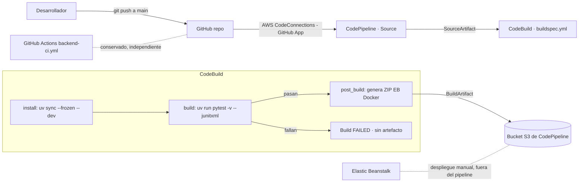

# Proyecto 1 · Entrega 2 — Integración Continua (CI)

**Microservicio de lista negra de emails · Grupo Blue Team**
Curso MISW-4302 DevOps: Agilizando el Despliegue Continuo de Aplicaciones · Universidad de los Andes

Documentación de la entrega: arquitectura, configuración en la consola de AWS y evidencias de las ejecuciones exitosa y fallida del pipeline. Este documento se exporta como `Proyecto 1 entrega 2 – Documento.pdf`.

---

## Tabla de contenido

- [Proyecto 1 · Entrega 2 — Integración Continua (CI)](#proyecto-1--entrega-2--integración-continua-ci)
  - [Tabla de contenido](#tabla-de-contenido)
  - [0. Rama principal: `main` en lugar de `master`](#0-rama-principal-main-en-lugar-de-master)
  - [1. Objetivo de la entrega](#1-objetivo-de-la-entrega)
  - [2. Alcance (solo CI)](#2-alcance-solo-ci)
    - [2.1 Relación con el workflow de GitHub Actions existente](#21-relación-con-el-workflow-de-github-actions-existente)
  - [3. Arquitectura de Integración Continua](#3-arquitectura-de-integración-continua)
  - [4. Pruebas unitarias del API](#4-pruebas-unitarias-del-api)
    - [4.1 Checklist endpoint → prueba](#41-checklist-endpoint--prueba)
    - [4.2 Ejecución de las pruebas](#42-ejecución-de-las-pruebas)
  - [5. Proceso de build y artefacto (AWS CodeBuild)](#5-proceso-de-build-y-artefacto-aws-codebuild)
    - [5.1 buildspec.yml](#51-buildspecyml)
    - [5.2 Empaquetado del artefacto](#52-empaquetado-del-artefacto)
  - [6. Configuración en la consola de AWS](#6-configuración-en-la-consola-de-aws)
    - [6.1 Conexión a GitHub (AWS CodeConnections / GitHub App)](#61-conexión-a-github-aws-codeconnections--github-app)
    - [6.2 Pipeline de CodePipeline](#62-pipeline-de-codepipeline)
    - [6.3 Proyecto de CodeBuild](#63-proyecto-de-codebuild)
    - [6.4 Roles y permisos](#64-roles-y-permisos)
  - [7. Evidencia de ejecución exitosa](#7-evidencia-de-ejecución-exitosa)
    - [Evidencias](#evidencias)
      - [Pipeline `blacklist-ci-pipeline` con Source y Build en Correcto, con el Execution ID](#pipeline-blacklist-ci-pipeline-con-source-y-build-en-correcto-con-el-execution-id)
      - [Detalle del build en CodeBuild con el Build run ID y la fase `build` en verde](#detalle-del-build-en-codebuild-con-el-build-run-id-y-la-fase-build-en-verde)
      - [Pestaña Informes con las pruebas aprobadas](#pestaña-informes-con-las-pruebas-aprobadas)
      - [Log de CloudWatch con `23 passed` y `Artifact created`](#log-de-cloudwatch-con-23-passed-y-artifact-created)
  - [8. Evidencia de ejecución fallida](#8-evidencia-de-ejecución-fallida)
    - [Evidencias](#evidencias-1)
      - [Pipeline con Build en rojo, con el Execution ID](#pipeline-con-build-en-rojo-con-el-execution-id)
      - [Log con el bloque FAILURES](#log-con-el-bloque-failures)
      - [Log con `2 failed, 22 passed`](#log-con-2-failed-22-passed)
      - [`post_build` con "Build is failing; skipping artifact packaging." y `UPLOAD_ARTIFACTS` fallido](#post_build-con-build-is-failing-skipping-artifact-packaging-y-upload_artifacts-fallido)
      - [Pestaña Informes con las 2 pruebas fallidas](#pestaña-informes-con-las-2-pruebas-fallidas)
      - [S3: código descargado en `SourceArti/`, sin artefacto nuevo en `BuildArtif/`](#s3-código-descargado-en-sourcearti-sin-artefacto-nuevo-en-buildartif)
      - [Log de CloudWatch de la ejecución fallida](#log-de-cloudwatch-de-la-ejecución-fallida)
      - [Pipeline de nuevo en verde tras la corrección](#pipeline-de-nuevo-en-verde-tras-la-corrección)
  - [9. Elastic Beanstalk y Postman](#9-elastic-beanstalk-y-postman)

---

## 0. Rama principal: `main` en lugar de `master`

El enunciado se refiere a la rama principal como **`master`**. En este repositorio la rama principal es **`main`**: es la que recibe los cambios integrados por el flujo del equipo (`feature/* → develop → main`) y, por lo tanto, cumple el rol que el enunciado llama `master`. El pipeline de AWS se dispara con cada push a `main`. No se creó una rama `master` adicional, para no mantener dos ramas principales que podrían divergir.

## 1. Objetivo de la entrega

Incorporar **Integración Continua** al microservicio de la entrega 1, de modo que cada cambio integrado a la rama principal (`main`) dispare automáticamente una canalización en AWS que:

1. Obtenga el código fuente desde GitHub.
2. Instale dependencias y ejecute las **pruebas unitarias** del API.
3. Genere un **artefacto desplegable** (ZIP para la plataforma Docker de Elastic Beanstalk) **solo si las pruebas pasan**.
4. Conserve ese artefacto en el almacén S3 de la canalización.

Esta entrega es **únicamente CI**: no incluye una etapa de despliegue automático a Elastic Beanstalk (no hay CD).

## 2. Alcance (solo CI)

| Incluido en esta entrega | No incluido |
|---|---|
| Pruebas unitarias por endpoint | Despliegue automático a Elastic Beanstalk |
| `buildspec.yml` para AWS CodeBuild | Entrega continua (CD) |
| Pipeline en AWS CodePipeline disparado por push a `main` | Promoción automática de ramas en AWS |
| Artefacto ZIP retenido en S3 | Cambios a producción o a datos existentes |

### 2.1 Relación con el workflow de GitHub Actions existente

El repositorio ya tiene `.github/workflows/backend-ci.yml`, que **se conserva sin cambios**. Son dos mecanismos con roles distintos:

| Aspecto | GitHub Actions `backend-ci.yml` (existente) | AWS CodePipeline + CodeBuild (esta entrega) |
|---|---|---|
| Rol | Verificación y **promoción de ramas** del equipo | **CI requerida de la entrega 2** |
| Disparo | Push con mensaje que empieza por `MERGE:` en `feature/**`, `develop`, `release/**`, `main`, `master` | Push a `main` vía CodeConnections |
| Qué hace | `uv sync`, `pytest -v`, `compileall`, cobertura; y promueve `feature → develop → release/<ts> → main` | Corre `pytest` y, solo si pasa, genera el **ZIP EB Docker** y lo retiene en S3 |
| Artefacto | `coverage.xml` (artifact de Actions) | ZIP desplegable (artifact store de CodePipeline) |
| Evidencia de la entrega | No | **Sí**: las ejecuciones exitosa y fallida salen de aquí |
| Deploy | No | No (CI only) |

La evidencia exigida (ejecución exitosa y fallida) se obtiene **exclusivamente de AWS CodePipeline**; GitHub Actions no sustituye ese requisito.

## 3. Arquitectura de Integración Continua



**Decisiones de diseño:**

- **Origen:** GitHub mediante **AWS CodeConnections** (GitHub App), el método recomendado por AWS frente al webhook/OAuth clásico.
- **Disparador:** push a la rama `main` (ver [sección 0](#0-rama-principal-main-en-lugar-de-master)).
- **Artefacto:** ZIP del código fuente versionado, en el formato que consume Elastic Beanstalk con plataforma Docker (mismo contenido que el `git archive` de la entrega 1).
- **Aislamiento de pruebas:** las pruebas usan SQLite en memoria y un secreto JWT fijo de prueba, así que el build **no depende de una base de datos en vivo** ni de secretos.

## 4. Pruebas unitarias del API

### 4.1 Checklist endpoint → prueba

| Endpoint | Método | Autenticación | Casos de éxito | Casos de error | Archivo de prueba |
|---|---|---|---|---|---|
| `/health` | GET | No requiere | `200 {"status":"ok"}` | — | `tests/test_health.py` |
| `/blacklists` | POST | Bearer JWT | `201` creado · persistencia de campos del servidor · sin `blocked_reason` · IP tomada de `X-Forwarded-For` | `409` duplicado · `400` campo faltante (`email`, `app_uuid`) · `400` formato inválido (`email`, `app_uuid`) · `400` `blocked_reason` > 255 · `400` campo desconocido · `400` body no-JSON · `401` token ausente/inválido | `tests/test_blacklist_create.py` |
| `/blacklists/<email>` | GET | Bearer JWT | `200` bloqueado (con motivo) · `200` no bloqueado · normalización de mayúsculas | `400` email vacío · `400` formato inválido · `401` token ausente/inválido | `tests/test_blacklist_query.py` |

Total: **23 pruebas**. Cada endpoint tiene al menos un escenario de éxito y los casos de error relevantes, sin alterar el contrato del API definido en la entrega 1.

### 4.2 Ejecución de las pruebas

Comando del proyecto, igual en local y en CodeBuild:

```bash
uv run pytest -v
```

Resultado en AWS CodeBuild (ver [sección 7](#7-evidencia-de-ejecución-exitosa)):

```
platform linux -- Python 3.12.15, pytest-9.1.1, pluggy-1.7.0
configfile: pyproject.toml
testpaths: tests
collecting ... collected 23 items
...
============================== 23 passed in 0.32s ==============================
```

## 5. Proceso de build y artefacto (AWS CodeBuild)

### 5.1 buildspec.yml

El archivo [`buildspec.yml`](../../buildspec.yml) en la raíz define cuatro fases:

| Fase | Acción |
|---|---|
| `install` | Instala Python 3.12 y `uv` (versión fijada, 0.9.5) y las dependencias exactas con `uv sync --frozen --dev`. |
| `pre_build` | Imprime diagnósticos (versión de Python, SHA de origen) y valida que el lock esté al día (`uv lock --locked`). |
| `build` | Ejecuta `uv run pytest -v --junitxml=reports/junit.xml`. Si una prueba falla, CodeBuild marca el build como **FAILED**. |
| `post_build` | Se ejecuta siempre, pero su primera instrucción verifica `CODEBUILD_BUILD_SUCCEEDING`: si el build falló, termina sin generar el artefacto; si sigue sano, genera el ZIP con `scripts/package_artifact.py`. |

Además:

- **`artifacts`** declara `*.zip` con `base-directory: dist`, de modo que CodePipeline retiene únicamente el ZIP generado.
- **`reports`** publica el resultado de pytest (JUnit XML) en la pestaña **Informes** de CodeBuild, con el detalle de cada prueba.
- **`cache`** conserva la caché de descargas de `uv` entre builds (requiere activar la caché en el proyecto de CodeBuild).

**Seguridad:** el `buildspec.yml` no contiene credenciales ni valores de cuenta, y las pruebas no requieren secretos. Si en el futuro se necesitara un valor sensible, debe inyectarse por variables de entorno de CodeBuild o AWS Secrets Manager / Parameter Store, nunca escrito en el archivo.

### 5.2 Empaquetado del artefacto

El script [`scripts/package_artifact.py`](../../scripts/package_artifact.py) genera un ZIP reproducible y trazable, nombrado con el SHA corto del commit (por ejemplo, `blacklist-service-501550b.zip`). En CodeBuild toma el SHA de la variable `CODEBUILD_RESOLVED_SOURCE_VERSION`, porque el código llega sin la carpeta `.git`.

**Incluye** lo necesario para la plataforma Docker de Elastic Beanstalk:

```
Dockerfile
.dockerignore
application.py
requirements.txt
pyproject.toml
uv.lock
app/**            (todo el paquete de la aplicación)
.ebextensions/**  (configuración del health check)
```

**Excluye** explícitamente: `.env` y cualquier `.env.*`, `tests/`, `scripts/`, `docs/`, `.venv/`, `__pycache__/`, `.git/`, archivos `*.pyc`, `*.zip` y `*.log`.

Contenido del ZIP (**17 archivos**, sin `.env` ni `tests/`):

```
Dockerfile
.dockerignore
application.py
requirements.txt
pyproject.toml
uv.lock
app/__init__.py
app/auth.py
app/config.py
app/extensions.py
app/models.py
app/resources/__init__.py
app/resources/blacklist_create.py
app/resources/blacklist_query.py
app/resources/health.py
app/schemas.py
.ebextensions/healthcheck.config
```

## 6. Configuración en la consola de AWS

> **Cuenta y región:** cuenta de AWS propia, región **us-east-1 (Norte de Virginia)**. CodeConnections, CodePipeline, CodeBuild y el bucket S3 de artefactos están en la misma región.

### 6.1 Conexión a GitHub (AWS CodeConnections / GitHub App)

1. *Herramientas para desarrolladores → Configuración → Conexiones → Crear conexión* (o **Conectarse a GitHub** desde el asistente del pipeline).
2. Proveedor: **GitHub**.
3. **Instalar una nueva aplicación** → autorizar la **AWS Connector for GitHub** solo sobre el repositorio del equipo (*Only select repositories*).
4. El estado de la conexión queda en **Disponible**.

### 6.2 Pipeline de CodePipeline

*CodePipeline → Crear canalización → Crear una canalización personalizada*

| Paso | Opción | Valor |
|---|---|---|
| Configuración | Nombre | `blacklist-ci-pipeline` |
| Configuración | Tipo | V2 |
| Configuración | Modo de ejecución | En cola (`QUEUED`) |
| Configuración | Rol de servicio | Nuevo: `AWSCodePipelineServiceRole-us-east-1-blacklist-ci-pipeline` |
| Configuración | Almacén de artefactos | Ubicación predeterminada (bucket S3 `codepipeline-us-east-1-…`) con clave administrada por AWS |
| Origen | Proveedor | GitHub (a través de GitHub App), con la conexión de la sección 6.1 |
| Origen | Repositorio | `camiloroa112/MISW-4302-DevOps-Agilizando-el-Despliegue-Continuo-de-Aplicaciones-202614-GrupoBlueTeam-proyecto` |
| Origen | Rama predeterminada | `main` |
| Origen | Formato del artefacto de salida | CodePipeline predeterminado (`CODE_ZIP`) → `SourceArtifact` |
| Origen | Reintento automático | Desactivado, para que un fallo quede registrado como fallo |
| Desencadenador | Tipo de evento | **Push** |
| Desencadenador | Filtro | Rama **`main`** |
| Compilación | Proveedor | AWS CodeBuild → proyecto `blacklist-ci-build-blueteam` (sección 6.3) |
| Compilación | Artefacto de entrada / salida | `SourceArtifact` / `BuildArtifact` |
| Compilación | Reintento automático | Desactivado |
| Prueba | — | Omitida |
| Implementación | — | **Omitida** (solo CI) |

En los pipelines V2, cuando se define un desencadenador con filtros, la acción Source queda con `DetectChanges: false`: es el **desencadenador** (Push → `main`) el que inicia el pipeline con cada commit en `main`.

### 6.3 Proyecto de CodeBuild

Creado desde el asistente de CodePipeline (etapa Compilación → **Crear proyecto**), que fija automáticamente la fuente y los artefactos del proyecto como CodePipeline.

| Opción | Valor |
|---|---|
| Nombre del proyecto | `blacklist-ci-build-blueteam` |
| Tipo de proyecto | Proyecto predeterminado |
| Cómputo | EC2, bajo demanda |
| Imagen | Administrada, contenedor, Amazon Linux, Standard: `aws/codebuild/amazonlinux-x86_64-standard:6.0` (siempre la versión más reciente) |
| Rol de servicio | Nuevo: `codebuild-blacklist-ci-build-service-role` |
| Modo privilegiado | No (el build no construye imágenes Docker) |
| Especificación de compilación | **Utilizar un archivo de especificación de compilación** → `buildspec.yml` en la raíz (sin comandos insertados en la consola) |
| Registros | CloudWatch Logs, grupo `/aws/codebuild/blacklist-ci-build-blueteam` |

### 6.4 Roles y permisos

- **Rol de CodePipeline** (creado por el asistente): uso de la conexión de CodeConnections, inicio de builds en CodeBuild y lectura/escritura en el bucket S3 de artefactos.
- **Rol de CodeBuild** (creado por el asistente): escritura de logs en CloudWatch, lectura/escritura en el bucket de artefactos y publicación de informes de pruebas.
- **No** se conceden permisos de despliegue (Elastic Beanstalk) a la canalización en esta entrega.

## 7. Evidencia de ejecución exitosa

**Objetivo:** un push a `main` dispara el pipeline; Source y Build terminan en **Correcto** y el ZIP queda en S3.

| Dato | Valor |
|---|---|
| Commit | `501550b` |
| Execution ID del pipeline | `bb57f411-9868-426f-bb58-e0187db75882` |
| Build run ID de CodeBuild | `blacklist-ci-build-blueteam:6fd4d11d-3591-4b57-b2d3-f36423830323` |
| Entorno | Python 3.12.15, uv 0.9.5, 27 paquetes desde `uv.lock` |
| Resultado de pruebas | **23 passed** |
| Artefacto | `blacklist-service-501550b.zip` (17 archivos) |
| Clave del artefacto en S3 | `blacklist-ci-pipelin/BuildArtif/mpBdAIT` |

**Hallazgos:**

- **Disparo automático:** el pipeline se ejecutó solo al llegar el commit a `main`, sin intervención manual. Esto confirma que el desencadenador (Push → `main`) funciona. Todas las ejecuciones del pipeline durante la entrega se iniciaron de esta forma, empezando por el merge del PR #16 que incorporó la configuración de CI.
- **Configuración versionada:** CodeBuild leyó el `buildspec.yml` desde la raíz del repositorio (`YAML location is .../src/buildspec.yml`). El proceso de build vive junto al código y cualquier cambio queda versionado y revisado.
- **Build reproducible:** las 27 dependencias se instalaron desde `uv.lock` con `uv sync --frozen`, las mismas versiones que en desarrollo local, y `uv lock --locked` verificó que el lock coincide con `pyproject.toml` antes de ejecutar las pruebas.
- **Pruebas sin infraestructura externa:** las 23 pruebas pasaron en menos de un segundo usando SQLite en memoria, sin base de datos real ni secretos en el pipeline.
- **Trazabilidad del artefacto:** el ZIP se nombró con el SHA del commit, tomado de `CODEBUILD_RESOLVED_SOURCE_VERSION`. Así se sabe exactamente qué versión del código contiene cada artefacto.
- **Artefacto mínimo:** el ZIP contiene solo los 17 archivos necesarios para ejecutar la aplicación en Elastic Beanstalk, sin pruebas, scripts, documentación ni archivos `.env`.
- **Resultados visibles en AWS:** el reporte JUnit se publicó en la pestaña Informes de CodeBuild, con el detalle de cada prueba.
- **Duración:** el build completo tomó alrededor de 15 segundos. La mayor parte se fue en instalar uv y las dependencias (~5 s); las pruebas, el empaquetado y la carga del artefacto tomaron menos de un segundo cada una.
- **Oportunidad de mejora:** uv mostró un aviso de rendimiento (`Failed to hardlink files`) porque la caché y el entorno virtual están en sistemas de archivos distintos. No afecta el resultado; se puede silenciar con `UV_LINK_MODE=copy` y, si se activa la caché del proyecto de CodeBuild, las siguientes ejecuciones instalarían las dependencias más rápido.

### Evidencias

#### Pipeline `blacklist-ci-pipeline` con Source y Build en Correcto, con el Execution ID


#### Detalle del build en CodeBuild con el Build run ID y la fase `build` en verde


#### Pestaña Informes con las pruebas aprobadas


#### Log de CloudWatch con `23 passed` y `Artifact created`


## 8. Evidencia de ejecución fallida

**Objetivo:** demostrar que, cuando una prueba falla, el pipeline **falla visiblemente en CodePipeline** y **no se genera artefacto**.

**Método:** se integró a `main` un cambio con dos pruebas que fallan a propósito, sin tocar el código de la aplicación:

- En `tests/test_blacklist_create.py`, `test_create_returns_201` se cambió para esperar un `200` en lugar del `201` que retorna el endpoint.
- Se agregó `tests/test_ci_failure_demo.py` con una aserción que siempre falla (`assert False, "Controlled CI failure demo"`).

Al llegar el commit a `main` (merge del PR #18), el desencadenador (Push → `main`) inició el pipeline automáticamente. Después, ambos cambios se revirtieron con un nuevo commit en `main` (`501550b`), que volvió a ejecutar el pipeline en verde (ver [sección 7](#7-evidencia-de-ejecución-exitosa)).

| Dato | Valor |
|---|---|
| Commit con las pruebas fallidas | `192035d` |
| Execution ID del pipeline | `1f3c78b8-6dfb-4bdc-8567-fea3095b9382` |
| Build run ID de CodeBuild | `blacklist-ci-build-blueteam:bc179c36-8b6e-46fc-a89c-04063bfb2170` |
| Resultado de pruebas | **2 failed, 22 passed** (24 pruebas) |
| Artefacto de origen en S3 | `blacklist-ci-pipelin/SourceArti/kk7eMR4` (código descargado de GitHub) |
| Artefacto de build en S3 | **No generado**: no existe ningún objeto en `BuildArtif/` para esta ejecución |
| Commit de corrección | `501550b` (pipeline de nuevo en verde) |

| Fase | Resultado |
|---|---|
| INSTALL / PRE_BUILD | Correcto |
| BUILD | **Fallido**: `test_create_returns_201` (`assert 201 == 200`) y `test_intentional_failure_demo` (`Controlled CI failure demo`) |
| POST_BUILD | **Fallido a propósito**: "Build is failing; skipping artifact packaging." |
| UPLOAD_ARTIFACTS | **Fallido**: `no matching base directory path found for dist`, porque el artefacto nunca se generó |

**Hallazgos:**

- El pipeline se disparó solo con el commit en `main`, igual que en la ejecución exitosa: la validación no depende de que alguien la lance a mano.
- El log identifica exactamente qué pruebas fallaron y por qué, con el valor obtenido frente al esperado (`assert 201 == 200`).
- La fase `post_build` se ejecutó, pero su verificación de `CODEBUILD_BUILD_SUCCEEDING` detuvo el empaquetado. Como `dist/` nunca se creó, la carga de artefactos también falló: **una versión con pruebas rotas nunca queda disponible para desplegarse**.
- **Sin artefacto en S3:** la etapa Source sí guardó el código descargado (`SourceArti/`), pero en `BuildArtif/` no aparece ningún objeto de esta ejecución. El pipeline obtuvo el código, lo probó y, al fallar las pruebas, no dejó ninguna versión disponible para desplegar.
- La pestaña **Informes** de CodeBuild muestra las 2 pruebas fallidas junto a las 22 aprobadas, sin necesidad de leer el log completo.
- Al revertir los cambios, el pipeline volvió a pasar, lo que confirma la corrección.

### Evidencias

#### Pipeline con Build en rojo, con el Execution ID


#### Log con el bloque FAILURES


#### Log con `2 failed, 22 passed`


#### `post_build` con "Build is failing; skipping artifact packaging." y `UPLOAD_ARTIFACTS` fallido


#### Pestaña Informes con las 2 pruebas fallidas


#### S3: código descargado en `SourceArti/`, sin artefacto nuevo en `BuildArtif/`


#### Log de CloudWatch de la ejecución fallida


#### Pipeline de nuevo en verde tras la corrección


## 9. Elastic Beanstalk y Postman

La aplicación de la entrega 1 sigue ejecutándose en Elastic Beanstalk y es accesible por Postman. El despliegue se hace **manualmente**, cargando en el entorno el artefacto generado por la ejecución exitosa; el pipeline no despliega, porque esta entrega cubre solo CI.

Las colecciones de Postman están en [`postman/`](../../postman/). La evidencia del entorno y de la colección se muestra en el video de sustentación.