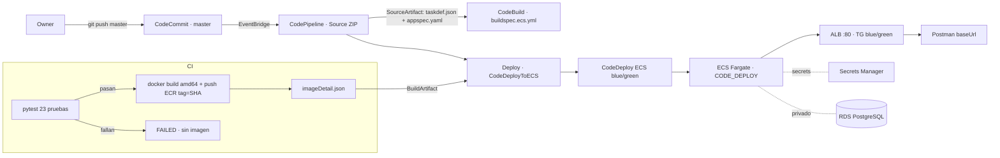

# Proyecto 1 · Entrega 3 — Entrega Continua (CD)

**Microservicio de lista negra de emails · Grupo Blue Team**
Curso MISW-4302 DevOps: Agilizando el Despliegue Continuo de Aplicaciones · Universidad de los Andes

> **Estado: BORRADOR.** Este documento es la fuente editable de `Proyecto 1 entrega 3 – Documento.pdf`.
> Los valores marcados **PENDIENTE** se completan con evidencia real tras la ejecución en AWS
> aprobada por el owner. Un borrador con capturas pendientes **no** es una entrega completa.

La sustentación en video (≤ 10 min, propiedad del equipo): **PENDIENTE (enlace)**.

---

## Tabla de contenido

- [0. Rama principal: `main` (equipo) y `master` (CodeCommit)](#0-rama-principal-main-equipo-y-master-codecommit)
- [1. Objetivo y alcance](#1-objetivo-y-alcance)
- [2. Arquitectura de CI/CD](#2-arquitectura-de-cicd)
- [3. Baseline manual en Fargate](#3-baseline-manual-en-fargate)
- [4. Flujo de disparo y artefactos](#4-flujo-de-disparo-y-artefactos)
- [5. Run CI OK / CD OK](#5-run-ci-ok--cd-ok)
- [6. Run CI FAIL / CD no ejecutado](#6-run-ci-fail--cd-no-ejecutado)
- [7. Run CI OK / CD FAIL](#7-run-ci-ok--cd-fail)
- [8. API viva y pruebas en Postman](#8-api-viva-y-pruebas-en-postman)
- [9. Checklist de capturas para el operador](#9-checklist-de-capturas-para-el-operador)

---

## 0. Rama principal: `main` (equipo) y `master` (CodeCommit)

El equipo integra en GitHub con el flujo `feature/* → develop → main`; `main` es la rama de
integración. El enunciado de la Entrega 3 pide **AWS CodeCommit `master`** como fuente del
pipeline. Por eso se usa CodeCommit `master` como origen de CI/CD, manteniendo GitHub `main`
como rama del equipo. La relación GitHub ↔ CodeCommit y la forma de publicar la revisión
aprobada: **PENDIENTE (verificación read-only del operador).**

## 1. Objetivo y alcance

Añadir **Entrega Continua** al microservicio de la Entrega 2: cada push a `master` en
CodeCommit dispara CodePipeline; CodeBuild corre las pruebas y, solo si pasan, construye y
publica la imagen en ECR; CodeDeploy despliega la imagen al servicio ECS Fargate (blue/green)
sin aprobación manual. Un build fallido impide el despliegue.

| Incluido | No incluido |
|---|---|
| Baseline manual en Fargate | Elastic Beanstalk como destino de CD |
| `buildspec.ecs.yml` (pruebas → imagen ECR) | Cambios al `buildspec.yml` de EB (se conserva) |
| `deploy/taskdef.json` + `deploy/appspec.yaml` | Aprobación manual en el camino normal |
| CodeDeploy ECS blue/green vía CodePipeline | — |

## 2. Arquitectura de CI/CD

**Contrato CodeDeployToECS:** la acción toma `taskdef.json` y `appspec.yaml` del artefacto de
origen, `imageDetail.json` (con `ImageURI`) del artefacto de build, reemplaza `<IMAGE1_NAME>`
en el taskdef (mapeo `Image1ContainerName = IMAGE1_NAME`) y `<TASK_DEFINITION>` en el appspec.

Verificación local de coherencia: `scripts/validate_deploy_artifacts.py` confirma que el
contenedor `blacklist` y el puerto `8000` coinciden en taskdef, appspec y Dockerfile, y que los
placeholders están presentes.

## 3. Baseline manual en Fargate

Procedimiento completo en [`deploy/create-fargate-baseline.md`](../../deploy/create-fargate-baseline.md).
Resumen: ECR + primera imagen (tag = SHA), secretos en Secrets Manager, log group, SGs (tasks
solo desde el ALB; RDS privado), ALB público con listener :80 y dos target groups IP
(blue/green), task definition Fargate x86_64 (contenedor `blacklist`, puerto 8000, `/health`),
y servicio ECS con controlador `CODE_DEPLOY`.

> **Hallazgo relevante:** la aplicación ejecuta `db.create_all()` al arrancar, por lo que la
> task **no inicia** sin una base de datos PostgreSQL alcanzable; el health check del ALB solo
> pasa cuando el worker de gunicorn arranca. Verificado localmente con un Postgres desechable.

| Dato del baseline | Valor |
|---|---|
| Cuenta / región | PENDIENTE |
| Cluster / servicio | PENDIENTE |
| Task definition (revisión) | PENDIENTE |
| Imagen (tag / digest) | PENDIENTE |
| DNS del ALB (`baseUrl`) | PENDIENTE |
| Base de datos | PENDIENTE (reusar `blacklist-db` si es usable) |

Evidencia: ECS task RUNNING, target group blue `healthy`, respuestas de Postman. **PENDIENTE (capturas).**

## 4. Flujo de disparo y artefactos

- **Disparo:** push a CodeCommit `master` → regla de EventBridge → CodePipeline. Polling
  desactivado para evitar ejecuciones duplicadas.
- **Artefacto de origen:** ZIP (`CODE_ZIP`) con `deploy/taskdef.json` y `deploy/appspec.yaml`.
- **Artefacto de build:** `imageDetail.json` con el `ImageURI` de la imagen recién publicada.
- **Tag de imagen:** SHA del commit resuelto (`CODEBUILD_RESOLVED_SOURCE_VERSION`), nunca `latest`.

## 5. Run CI OK / CD OK

| Dato | Valor |
|---|---|
| Fecha / zona horaria | PENDIENTE |
| Commit (SHA) | PENDIENTE |
| Execution ID (CodePipeline) | PENDIENTE |
| Build ID (CodeBuild) | PENDIENTE |
| Resultado de pruebas | PENDIENTE (esperado: 23 passed) |
| Imagen (tag / digest) | PENDIENTE |
| Deployment ID (CodeDeploy) | PENDIENTE |
| Revisión task definition en ejecución | PENDIENTE |
| Resultado observado | PENDIENTE |

- **Cambio introducido:** cambio seguro con pruebas que pasan.
- **Resultado esperado:** build verde, imagen publicada, CodeDeploy despliega la nueva revisión.
- **Resultado observado:** PENDIENTE.
- **Hallazgo:** PENDIENTE.
- **Efecto en el servicio:** PENDIENTE.
- Evidencia: **PENDIENTE (capturas).**

## 6. Run CI FAIL / CD no ejecutado

| Dato | Valor |
|---|---|
| Fecha / zona horaria | PENDIENTE |
| Commit con la aserción fallida (SHA) | PENDIENTE |
| Execution ID | PENDIENTE |
| Build ID | PENDIENTE |
| Resultado de pruebas | PENDIENTE (esperado: ≥1 failed) |
| Acción Deploy | PENDIENTE (esperado: no ejecutada) |
| Commit de revert (SHA) | PENDIENTE |

- **Cambio introducido:** una aserción fallida real en una prueba unitaria (p. ej. esperar 200
  en lugar de 201 en `test_create_returns_201`).
- **Resultado esperado:** CodeBuild falla, no se publica imagen, no hay acción Deploy; el
  servicio existente sigue sano.
- **Resultado observado / causa raíz / efecto:** PENDIENTE.
- **Qué restauró el estado sano:** el revert publicado por el owner. PENDIENTE verificar recuperación.
- Evidencia (incl. log de CloudWatch con la prueba que falló): **PENDIENTE (capturas).**

## 7. Run CI OK / CD FAIL

Ruta elegida (A hook de validación / B override de task definition): **PENDIENTE** (depende de
permisos de Lambda en Academy). Detalle en [`deploy/cd-fail/README.md`](../../deploy/cd-fail/README.md).

| Dato | Valor |
|---|---|
| Fecha / zona horaria | PENDIENTE |
| Commit (SHA) | PENDIENTE |
| Execution ID | PENDIENTE |
| Build ID | PENDIENTE (esperado: verde) |
| Imagen publicada (tag / digest) | PENDIENTE |
| Deployment ID (CodeDeploy) | PENDIENTE |
| Motivo de fallo de CodeDeploy | PENDIENTE |
| Commit de revert (SHA) | PENDIENTE |

- **Cambio introducido:** cambio de despliegue que hace fallar CodeDeploy (hook `Failed` u
  override de health check), con CI verde e imagen publicada.
- **Resultado esperado:** CodeDeploy crea un despliegue y lo reporta fallido; el task set
  estable sigue sirviendo; rollback o estabilidad.
- **Resultado observado / causa raíz / efecto:** PENDIENTE.
- **Qué restauró el estado sano:** el revert publicado por el owner. PENDIENTE verificar recuperación.
- Evidencia: **PENDIENTE (capturas).**

> Distinguir el **despliegue fallido intencional** del **despliegue de recuperación**.

## 8. API viva y pruebas en Postman

- **URL viva (`baseUrl`):** PENDIENTE (DNS del ALB).
- **Cómo probar:** en la colección
  [`postman/Blacklist API - Entrega 3 CD.postman_collection.json`](../../postman/) fijar
  `baseUrl = http://<DNS-del-ALB>` y `token = <JWT>` (generar con
  [`scripts/generate_token.py`](../../scripts/generate_token.py) usando el mismo
  `JWT_SECRET_KEY` del servicio) y ejecutar *Run collection*.
- Casos: `/health` (200), `POST /blacklists` (201, email desechable), `GET /blacklists/<email>`
  (true/false), `POST` sin token (401).
- Redactar credenciales y datos sensibles en todas las capturas.

## 9. Checklist de capturas para el operador

Nombrar los archivos con el prefijo del escenario para ordenarlos.

### Baseline (R-FARGATE)
- `baseline-01-ecs-service-running.png` — ECS → Clusters → `blacklist-cluster` → servicio:
  task RUNNING, `Deployment controller = CODE_DEPLOY`.
- `baseline-02-alb-target-healthy.png` — EC2 → Target Groups → `blacklist-tg-blue`: target `healthy`.
- `baseline-03-postman-health-201.png` — Postman: `/health` 200 y `POST` 201 desde `baseUrl`.

### Run CI OK / CD OK (R-DOC-SUCCESS)
- `ok-01-pipeline-success.png` — CodePipeline: Source, Build y Deploy en éxito, con Execution ID.
- `ok-02-codebuild-tests.png` — CodeBuild: fase de build con las 23 pruebas y SHA del commit.
- `ok-03-ecr-image.png` — ECR: imagen con tag = SHA y su digest.
- `ok-04-codedeploy-success.png` — CodeDeploy: despliegue exitoso con Deployment ID.
- `ok-05-ecs-revision.png` — ECS: revisión en ejecución = imagen del build.
- `ok-06-postman-ok.png` — Postman: respuestas 200/201 desde el ALB.

### Run CI FAIL (R-DOC-CI-FAIL)
- `cifail-01-pipeline-build-red.png` — CodePipeline: Build en rojo, con Execution ID y SHA.
- `cifail-02-cloudwatch-failing-test.png` — CloudWatch: log con la prueba que falló y el motivo.
- `cifail-03-no-deploy-action.png` — CodePipeline: la acción Deploy no se ejecutó.
- `cifail-04-service-healthy.png` — ECS/Postman: el servicio existente sigue sano.
- `cifail-05-recovery-green.png` — CodePipeline: verde tras el revert.

### Run CD FAIL (R-DOC-CD-FAIL)
- `cdfail-01-codebuild-green.png` — CodeBuild verde y su imagen publicada en ECR.
- `cdfail-02-pipeline-deploy-red.png` — CodePipeline: acción Deploy fallida, con Execution ID.
- `cdfail-03-codedeploy-failure.png` — CodeDeploy: Deployment ID y motivo del fallo.
- `cdfail-04-stable-taskset-or-hook.png` — ECS/ALB o log del hook: task set estable sano / hook `Failed`.
- `cdfail-05-postman-available.png` — Postman: el servicio sigue disponible.
- `cdfail-06-recovery-green.png` — CodePipeline + CodeDeploy: recuperación tras el revert.
