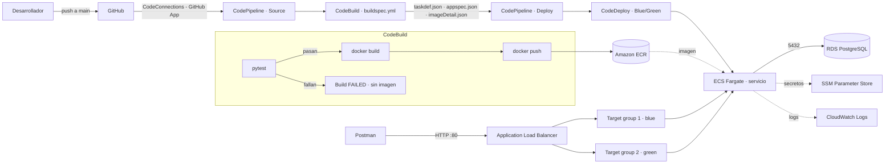

# Proyecto 1 · Entrega 3 — Entrega Continua (CD) sobre AWS Fargate
 
**Microservicio de lista negra de emails · Grupo Blue Team**
Curso MISW-4302 DevOps: Agilizando el Despliegue Continuo de Aplicaciones · Universidad de los Andes
 
Documentación de la entrega: despliegue del microservicio en AWS Fargate, pipeline de integración y entrega continua (CodePipeline + CodeBuild + CodeDeploy con estrategia blue/green) y evidencias de las ejecuciones. Este documento se exporta como `Proyecto 1 entrega 3 – Documento.pdf`.
 
---
 
## Tabla de contenido
 
- [Proyecto 1 · Entrega 3 — Entrega Continua (CD) sobre AWS Fargate](#proyecto-1--entrega-3--entrega-continua-cd-sobre-aws-fargate)
  - [Tabla de contenido](#tabla-de-contenido)
  - [0. Rama principal: `main` en lugar de `master`](#0-rama-principal-main-en-lugar-de-master)
  - [1. Objetivo de la entrega](#1-objetivo-de-la-entrega)
  - [2. Arquitectura](#2-arquitectura)
  - [3. Recursos de AWS](#3-recursos-de-aws)
  - [4. Despliegue manual en AWS Fargate](#4-despliegue-manual-en-aws-fargate)
    - [4.1 Imagen en Amazon ECR](#41-imagen-en-amazon-ecr)
    - [4.2 Red, base de datos y secretos](#42-red-base-de-datos-y-secretos)
    - [4.3 Balanceador de carga y grupos de destino](#43-balanceador-de-carga-y-grupos-de-destino)
    - [4.4 Definición de tarea, clúster y servicio](#44-definición-de-tarea-clúster-y-servicio)
    - [4.5 Validación con Postman](#45-validación-con-postman)
  - [5. Archivos de configuración en el repositorio](#5-archivos-de-configuración-en-el-repositorio)
    - [`buildspec.yml`](#buildspecyml)
    - [`appspec.json`](#appspecjson)
    - [`taskdef.json`](#taskdefjson)
  - [6. Pipeline de CI/CD](#6-pipeline-de-cicd)
    - [6.1 AWS CodeDeploy](#61-aws-codedeploy)
    - [6.2 AWS CodeBuild](#62-aws-codebuild)
    - [6.3 AWS CodePipeline](#63-aws-codepipeline)
  - [7. Evidencias de las ejecuciones](#7-evidencias-de-las-ejecuciones)
    - [7.1 CI fallido](#71-ci-fallido)
    - [7.2 CI exitoso y CD exitoso](#72-ci-exitoso-y-cd-exitoso)
    - [7.3 CI exitoso y CD fallido](#73-ci-exitoso-y-cd-fallido)
  - [8. Hallazgos de la configuración](#8-hallazgos-de-la-configuración)
---
 
## 0. Rama principal: `main` en lugar de `master`
 
El enunciado se refiere a la rama principal como **`master`**. En este repositorio la rama principal es **`main`**, que recibe los cambios integrados por el flujo del equipo y cumple el rol que el enunciado llama `master`. El pipeline se dispara con cada push a `main`.
 
## 1. Objetivo de la entrega
 
Automatizar la entrega del microservicio de las entregas 1 y 2 sobre una plataforma de contenedores gestionada por AWS. Cada cambio integrado a `main` dispara un pipeline que:
 
1. Obtiene el código desde GitHub.
2. Ejecuta las **pruebas unitarias** y, solo si pasan, construye la **imagen de Docker** y la publica en Amazon ECR.
3. Despliega la nueva versión en **AWS Fargate** con una estrategia **blue/green** administrada por AWS CodeDeploy, sin interrumpir el servicio.
| Componente evaluado | Peso | Sección |
|---|---|---|
| Despliegue del microservicio en AWS Fargate | 20 % | [4](#4-despliegue-manual-en-aws-fargate) |
| Archivos de configuración para CodeDeploy, con pruebas en el build | 10 % | [5](#5-archivos-de-configuración-en-el-repositorio) |
| Build automático en cada commit a `main`, con creación de la imagen | 10 % | [6.2](#62-aws-codebuild), [6.3](#63-aws-codepipeline) |
| Despliegue continuo automático a Fargate tras un CI exitoso | 40 % | [6.1](#61-aws-codedeploy), [6.3](#63-aws-codepipeline) |
| Documento con las tres ejecuciones | 20 % | [7](#7-evidencias-de-las-ejecuciones) |
 
## 2. Arquitectura
 

 
**Decisiones de diseño:**
 
- **Fargate** ejecuta los contenedores sin administrar servidores; ECS mantiene una tarea en ejecución y la registra en el balanceador.
- **Blue/green con CodeDeploy:** la versión nueva (green) se levanta en un segundo grupo de destino. Cuando sus comprobaciones de estado pasan, el listener de producción cambia al 100 % hacia green y, cinco minutos después, se apaga la versión anterior (blue). Si el despliegue falla, CodeDeploy revierte automáticamente.
- **Secretos fuera del repositorio:** la contraseña de la base de datos y la clave JWT se guardan en **SSM Parameter Store** (SecureString) y ECS las inyecta en la tarea al arrancar.
- **Configuración principalmente por AWS CLI:** los recursos de ECS y CodeDeploy que necesitan opciones no disponibles en la consola (controlador `CODE_DEPLOY`, grupo de implementación blue/green, secretos) se crearon con comandos en AWS CloudShell. Los comandos están documentados en las secciones 4 y 6.
## 3. Recursos de AWS
 
Cuenta de AWS propia, región **us-east-1 (Norte de Virginia)**.
 
| Servicio | Recurso | Configuración principal |
|---|---|---|
| Amazon ECR | `blacklist-service` | Repositorio privado, etiquetas mutables |
| Amazon VPC | `blacklist-vpc-vpc` | `172.30.0.0/16`, 2 subredes públicas (us-east-1a, us-east-1b), sin NAT Gateway |
| Amazon RDS | `blacklist-db` | PostgreSQL, `db.t4g.micro`, 20 GB, una zona, sin acceso público, base inicial `blacklist` |
| SSM Parameter Store | `/blacklist/DB_PASSWORD`, `/blacklist/JWT_SECRET_KEY` | SecureString |
| EC2 · Grupos de seguridad | `blacklist-service-sg` | Entrada: 80 y 8080 desde internet; 5000 solo desde el propio grupo (balanceador → tareas) |
| | Grupo de RDS | Entrada: 5432 solo desde `blacklist-service-sg` |
| EC2 · Grupos de destino | `blacklist-service-group-1` / `-2` | Tipo IP, HTTP 5000, health check `/health`, intervalo 10 s, umbrales 2/2 |
| Elastic Load Balancing | `load-balancer-blacklist-service` | ALB público; listener 80 (producción) y 8080 (prueba) |
| Amazon ECS | `cluster-blacklist-service` | Clúster Fargate |
| | Definición de tarea `blacklist-service-python` | 0.5 vCPU, 1 GB, contenedor `blacklist-app`, puerto 5000 |
| | Servicio `blacklist-service-codedeploy` | Fargate, 1 tarea, controlador `CODE_DEPLOY` |
| CloudWatch Logs | `/ecs/blacklist-service-python`, `/aws/codebuild/blacklist-service-build` | Logs de la aplicación y del build |
| AWS CodeDeploy | `blacklist-service-app` / `blacklist-service-dg` | Plataforma ECS, blue/green, `ECSAllAtOnce`, rollback automático |
| AWS CodeBuild | `blacklist-service-build` | Ubuntu `standard:8.0`, modo privilegiado, sin VPC, `buildspec.yml` |
| AWS CodePipeline | `blacklist-cicd-pipeline` | V2, Source → Build → Deploy, disparo por push a `main` |
| IAM | `ecsTaskExecutionRole` | `AmazonECSTaskExecutionRolePolicy` + política insertada `ReadBlacklistSecrets` (`ssm:GetParameters` sobre `/blacklist/*`) |
| | `ecsCodeDeployRole` | Rol de servicio de CodeDeploy para ECS |
| | `codebuild-blacklist-service-build-service-role` | + `AmazonEC2ContainerRegistryPowerUser` |
| | `AWSCodePipelineServiceRole-us-east-1-blacklist-cicd-pipeline` | Creado por el asistente de CodePipeline |
 
## 4. Despliegue manual en AWS Fargate
 
Antes de automatizar, el microservicio se desplegó manualmente para validar la configuración de red, base de datos, secretos y balanceador.
 
### 4.1 Imagen en Amazon ECR
 
Desde el equipo local, con el repositorio `blacklist-service` creado en ECR:
 
```bash
aws ecr get-login-password --region us-east-1 | docker login --username AWS --password-stdin 773658095475.dkr.ecr.us-east-1.amazonaws.com
docker build -t 773658095475.dkr.ecr.us-east-1.amazonaws.com/blacklist-service:latest .
docker push 773658095475.dkr.ecr.us-east-1.amazonaws.com/blacklist-service:latest
```
 
El contenedor ejecuta la aplicación con gunicorn en el puerto **5000** (`EXPOSE 5000` en el `Dockerfile`).
 
<!-- CAPTURA: ECR → blacklist-service con la imagen latest -->
 
### 4.2 Red, base de datos y secretos
 
1. **VPC** con dos subredes públicas en zonas distintas (requisito de RDS y del balanceador) y sin NAT Gateway, para no generar costos por hora.
2. **RDS PostgreSQL** `blacklist-db` sin acceso público. Su grupo de seguridad solo acepta conexiones al puerto 5432 desde el grupo de seguridad de las tareas.
3. **Secretos en SSM Parameter Store** como SecureString: `/blacklist/DB_PASSWORD` y `/blacklist/JWT_SECRET_KEY`.
4. **Permiso de lectura de secretos** para el rol de ejecución de tareas:
```bash
aws iam put-role-policy --role-name ecsTaskExecutionRole --policy-name ReadBlacklistSecrets \
  --policy-document '{"Version":"2012-10-17","Statement":[{"Effect":"Allow","Action":"ssm:GetParameters","Resource":"arn:aws:ssm:us-east-1:773658095475:parameter/blacklist/*"}]}'
```
 
<!-- CAPTURA: RDS → blacklist-db en estado Disponible -->
<!-- CAPTURA: Systems Manager → Almacén de parámetros con los dos SecureString (sin mostrar valores) -->
 
### 4.3 Balanceador de carga y grupos de destino
 
- Dos grupos de destino idénticos, `blacklist-service-group-1` (blue) y `blacklist-service-group-2` (green): tipo **IP** (requisito de Fargate), HTTP **5000** y comprobación de estado en **`/health`**, el endpoint que responde 200 sin token.
- Application Load Balancer público con dos listeners:
  - **HTTP:80** (producción) → `blacklist-service-group-1`
  - **HTTP:8080** (prueba) → `blacklist-service-group-2`
<!-- CAPTURA: EC2 → load-balancer-blacklist-service → Agentes de escucha y reglas -->
 
### 4.4 Definición de tarea, clúster y servicio
 
**Definición de tarea `blacklist-service-python`:** Fargate, 0.5 vCPU, 1 GB, contenedor `blacklist-app` en el puerto 5000, variables `DB_HOST`, `DB_PORT`, `DB_NAME` y `DB_USER`, y los secretos `DB_PASSWORD` y `JWT_SECRET_KEY` leídos desde SSM. Su contenido es el mismo de [`taskdef.json`](../../taskdef.json).
 
**Servicio con controlador `CODE_DEPLOY`**, creado por CLI porque la consola no permite elegir este controlador:
 
```bash
TG1=$(aws elbv2 describe-target-groups --names blacklist-service-group-1 --query 'TargetGroups[0].TargetGroupArn' --output text)
SUBNETS=$(aws ec2 describe-subnets --filters Name=vpc-id,Values=vpc-04f2e070e7db13ce4 --query 'Subnets[].SubnetId' --output text | tr '\t' ',')
 
aws ecs create-service \
  --cluster cluster-blacklist-service \
  --service-name blacklist-service-codedeploy \
  --task-definition blacklist-service-python:3 \
  --load-balancers "targetGroupArn=$TG1,containerName=blacklist-app,containerPort=5000" \
  --desired-count 1 \
  --launch-type FARGATE \
  --deployment-controller type=CODE_DEPLOY \
  --network-configuration "awsvpcConfiguration={subnets=[$SUBNETS],securityGroups=[sg-0329008ea51961006],assignPublicIp=ENABLED}"
```
 
<!-- CAPTURA: ECS → cluster-blacklist-service → servicio con 1/1 tareas en ejecución -->
<!-- CAPTURA: EC2 → Grupos de destino → blacklist-service-group-1 con el destino Healthy -->
 
### 4.5 Validación con Postman
 
La colección de [`postman/`](../../postman/) se ejecutó contra el DNS del balanceador (`http://load-balancer-blacklist-service-2095876957.us-east-1.elb.amazonaws.com`), con la variable `base_url` apuntando al balanceador y el token JWT generado con la clave almacenada en SSM.
 
| Resultado | Valor |
|---|---|
| `GET /health` | 200 `{"status": "ok"}` |
| Ejecución de la colección | **34 pruebas aprobadas** |
 
<!-- CAPTURA: Postman → resumen del Run collection (sin mostrar el token) -->
 
## 5. Archivos de configuración en el repositorio
 
| Archivo | Lo usa | Función |
|---|---|---|
| [`buildspec.yml`](../../buildspec.yml) | CodeBuild | Corre las pruebas, construye la imagen, la publica en ECR y genera los artefactos para el despliegue |
| [`appspec.json`](../../appspec.json) | CodeDeploy | Indica el contenedor (`blacklist-app`) y el puerto (5000) al que el balanceador envía el tráfico |
| [`taskdef.json`](../../taskdef.json) | CodeDeploy | Plantilla de la definición de tarea; CodeDeploy reemplaza `<IMAGE1_NAME>` por la imagen recién construida |
| [`Dockerfile`](../../Dockerfile) | CodeBuild | Imagen de la aplicación; la imagen base se descarga de **ECR Public** (ver [hallazgos](#8-hallazgos-de-la-configuración)) |
 
### `buildspec.yml`
 
| Fase | Acción |
|---|---|
| `install` | Instala `uv` (versión fijada) y las dependencias exactas de `uv.lock`, incluidas las de desarrollo |
| `pre_build` | Valida que `uv.lock` esté al día, calcula el URI del repositorio y la etiqueta (SHA corto del commit) y autentica Docker contra ECR |
| `build` | Ejecuta `uv run pytest` con reporte JUnit. **Solo si las pruebas pasan**, construye la imagen y la etiqueta con el SHA y como `latest` |
| `post_build` | Si el build sigue sano (`CODEBUILD_BUILD_SUCCEEDING`), publica las dos etiquetas en ECR y genera `imagedefinitions.json` e `imageDetail.json` |
 
**Artefactos de salida:** `imageDetail.json`, `imagedefinitions.json`, `appspec.json` y `taskdef.json`. El reporte de pytest se publica en la pestaña **Informes** de CodeBuild.
 
Las pruebas usan SQLite en memoria y un secreto fijo de prueba, así que el build no necesita acceso a la base de datos ni a los secretos de producción.
 
### `appspec.json`
 
```json
{
  "version": 1,
  "Resources": [
    {
      "TargetService": {
        "Type": "AWS::ECS::Service",
        "Properties": {
          "TaskDefinition": "<TASK_DEFINITION>",
          "LoadBalancerInfo": {
            "ContainerName": "blacklist-app",
            "ContainerPort": 5000
          }
        }
      }
    }
  ]
}
```
 
`<TASK_DEFINITION>` lo reemplaza CodePipeline con el ARN de la nueva revisión registrada a partir de `taskdef.json`.
 
### `taskdef.json`
 
Refleja la definición de tarea desplegada manualmente. Puntos clave:
 
- `"image": "<IMAGE1_NAME>"`: marcador que CodePipeline reemplaza con el URI de `imageDetail.json`.
- `DB_PASSWORD` y `JWT_SECRET_KEY` van en **`secrets`** con el ARN del parámetro de SSM. No hay contraseñas en el repositorio.
- El nombre del contenedor (`blacklist-app`) y el puerto (5000) coinciden con `appspec.json`, el servicio de ECS y los grupos de destino.
## 6. Pipeline de CI/CD
 
### 6.1 AWS CodeDeploy
 
Aplicación y grupo de implementación creados por CLI en CloudShell:
 
```bash
LB=$(aws elbv2 describe-target-groups --names blacklist-service-group-1 --query 'TargetGroups[0].LoadBalancerArns[0]' --output text)
LISTENER80=$(aws elbv2 describe-listeners --load-balancer-arn $LB --query 'Listeners[?Port==`80`].ListenerArn' --output text)
 
aws deploy create-application --application-name blacklist-service-app --compute-platform ECS
 
aws deploy create-deployment-group \
  --application-name blacklist-service-app \
  --deployment-group-name blacklist-service-dg \
  --service-role-arn arn:aws:iam::773658095475:role/ecsCodeDeployRole \
  --deployment-config-name CodeDeployDefault.ECSAllAtOnce \
  --deployment-style '{"deploymentType":"BLUE_GREEN","deploymentOption":"WITH_TRAFFIC_CONTROL"}' \
  --ecs-services "clusterName=cluster-blacklist-service,serviceName=blacklist-service-codedeploy" \
  --load-balancer-info "{\"targetGroupPairInfoList\":[{\"targetGroups\":[{\"name\":\"blacklist-service-group-1\"},{\"name\":\"blacklist-service-group-2\"}],\"prodTrafficRoute\":{\"listenerArns\":[\"$LISTENER80\"]}}]}" \
  --blue-green-deployment-configuration '{"terminateBlueInstancesOnDeploymentSuccess":{"action":"TERMINATE","terminationWaitTimeInMinutes":5},"deploymentReadyOption":{"actionOnTimeout":"CONTINUE_DEPLOYMENT"}}' \
  --auto-rollback-configuration '{"enabled":true,"events":["DEPLOYMENT_FAILURE"]}'
```
 
| Opción | Valor | Efecto |
|---|---|---|
| Tipo | Blue/green con control de tráfico | La versión nueva corre en paralelo a la actual |
| Configuración | `CodeDeployDefault.ECSAllAtOnce` | El tráfico pasa al 100 % en un solo paso |
| Listener de producción | HTTP:80 | Es el listener que CodeDeploy cambia de grupo de destino |
| Espera antes de apagar blue | 5 minutos | Ventana para revertir manualmente si se detecta un problema |
| Rollback automático | Ante `DEPLOYMENT_FAILURE` | Si green no queda sano, el tráfico permanece en blue |
 
<!-- CAPTURA: CodeDeploy → blacklist-service-app → blacklist-service-dg (configuración) -->
 
### 6.2 AWS CodeBuild
 
| Opción | Valor |
|---|---|
| Nombre | `blacklist-service-build` |
| Entorno | EC2 bajo demanda · imagen administrada · Ubuntu · `aws/codebuild/standard:8.0` |
| **Modo privilegiado** | **Activado**, necesario para ejecutar `docker build` |
| VPC | Ninguna: el build necesita salida a internet para descargar dependencias |
| Especificación | `buildspec.yml` del repositorio |
| Webhook propio | **Desactivado**: el build lo dispara solo el pipeline, para evitar ejecuciones duplicadas |
| Rol | `codebuild-blacklist-service-build-service-role` + `AmazonEC2ContainerRegistryPowerUser` |
 
<!-- CAPTURA: CodeBuild → blacklist-service-build → Detalles del proyecto (entorno y buildspec) -->
 
### 6.3 AWS CodePipeline
 
| Etapa | Proveedor | Configuración |
|---|---|---|
| **Source** | GitHub (GitHub App) | Conexión `github-blacklist-blueteam`, rama `main`, salida `SourceArtifact` |
| **Build** | AWS CodeBuild | Proyecto `blacklist-service-build`, entrada `SourceArtifact`, salida `BuildArtifact` |
| **Deploy** | Amazon ECS (Blue/Green) | Aplicación `blacklist-service-app`, grupo `blacklist-service-dg`; `taskdef.json` y `appspec.json` desde `BuildArtifact`; imagen desde `BuildArtifact` con el marcador `IMAGE1_NAME`; reversión automática activada |
 
- **Disparador:** evento **Push** en la rama **`main`**. Cada commit integrado ejecuta automáticamente Source → Build → Deploy.
- **Modo de ejecución:** en cola, para que commits seguidos no se cancelen entre sí.
- **Reintento automático:** desactivado en todas las etapas, para que un fallo quede registrado como fallo.
<!-- CAPTURA: CodePipeline → blacklist-cicd-pipeline → pestaña Canalización con las tres etapas -->
<!-- CAPTURA: CodePipeline → Editar → Desencadenadores de Git (Push, main) -->
 
## 7. Evidencias de las ejecuciones
 
### 7.1 CI fallido
 
**Objetivo:** demostrar que, si una prueba falla, el pipeline se detiene en Build, no se publica imagen y no se despliega nada.
 
**Método:** se integró a `main` un cambio que rompe una prueba unitaria sin tocar el código de la aplicación (`test_create_returns_201` esperando `200` en lugar de `201`). Después se revirtió con un nuevo commit.
 
| Dato | Valor |
|---|---|
| Commit | 9973acc7 |
| Execution ID del pipeline | 35067cd2-a0ff-45d9-be5f-8d681650d20e |
| Build ID de CodeBuild | 1d0e1267-ee66-49fd-818d-34b8a38366ef |
| Resultado de pruebas | PENDIENTE (esperado: 1 failed) |
| Imagen en ECR para ese commit | No generada |
| Etapa Deploy | No ejecutada |
 
**Hallazgos:**
 
### CAPTURA: pipeline con Build en rojo y Deploy sin ejecutar


### CAPTURA: log de CodeBuild con el bloque FAILURES y el resumen de pytest


### CAPTURA: post_build con "Build is failing; skipping image push."

 
### 7.2 CI exitoso y CD exitoso
 
**Objetivo:** un commit a `main` recorre todo el pipeline: pasan las pruebas, se publica la imagen y CodeDeploy la despliega con blue/green sin interrumpir el servicio.
 
| Dato | Valor |
|---|---|
| Commit | 04315d4e |
| Execution ID del pipeline | 37ae3316-7760-42d8-afd6-8781cbb40594 |
| Build ID de CodeBuild | ff005a0a-8a8b-4b45-98d4-971cf8a0e79d |
| Resultado de pruebas | Deployment d-AMN62SHSM succeeded |
| Imagen publicada | sha256:9d304a2a6481d964d509bb70ab3ec6b648742b206fb9ce5a6d97a1d1be67f2a2 |
| ID de implementación de CodeDeploy | d-AMN62SHSM |
| Nueva revisión de la tarea | blacklist-service-python:4 |
 
**Hallazgos:**
 
### CAPTURA: Pipeline con Source, Build y Deploy en verde


### CAPTURA: Desplazamiento de tráfico


### CAPTURA: ECR con la imagen etiquetada con el SHA del commit

 
### 7.3 CI exitoso y CD fallido
 
**Objetivo:** demostrar que, si la versión nueva no queda sana, CodeDeploy falla el despliegue y **revierte** automáticamente a la versión anterior, sin afectar el servicio.
 
**Método:** se integró a `main` un cambio en `taskdef.json` que deja a la tarea nueva sin poder arrancar, sin tocar el código ni las pruebas. Las pruebas pasan (usan SQLite en memoria), la imagen se publica, pero la tarea green no supera las comprobaciones de estado. Después se revirtió con un nuevo commit.
 
| Dato | Valor |
|---|---|
| Commit | f84c28e1  |
| Cambio introducido | Modificación del nombre del contenedor en appspec.json, pasando de blacklist-app a blacklist-apx |
| Execution ID del pipeline | becc6be2-0dda-435e-bb7f-d66a750577a7 |
| Resultado del Build | Exitoso · PENDIENTE |
| ID de implementación de CodeDeploy | d-J5EWQAJSM |
| Motivo del fallo | The ECS service cannot be updated due to an unexpected error: The container blacklist-apx does not exist in the task definition. (Service: AmazonECS; Status Code: 400; Error Code: InvalidParameterException; Request ID: 9031a966-0a90-42a1-b790-c19417c52cb8; Proxy: null). Check your ECS service status. |
| Rollback | d-J5EWQAJSM, Realizado correctamente, de 1:50 a 1:57 a. m. Es la reversión automática que hizo CodeDeploy. |
 
**Hallazgos:**
 
### CAPTURA: Pipeline con Build en verde y Deploy en rojo


### CAPTURA: CodeDeploy → implementación fallida con el motivo y el rollback


### CAPTURA: /health respondiendo durante el fallo

 
## 8. Hallazgos de la configuración
 
Problemas encontrados durante la configuración y cómo se resolvieron:
 
| Problema | Causa | Solución |
|---|---|---|
| El build falló en `docker build` con `429 Too Many Requests` | Docker Hub limita las descargas anónimas desde IPs compartidas de AWS | La imagen base se cambió a `public.ecr.aws/docker/library/python:3.12-slim` (copia oficial en ECR Public) |
| La tarea se detenía con `password authentication failed` | `DB_PASSWORD` y `JWT_SECRET_KEY` quedaron como variables de entorno en texto plano, no como secretos | Se registró una nueva revisión con ambos valores en `secrets` (SSM) y se recreó el servicio |
| `503 Service Temporarily Unavailable` en el balanceador | Ninguna tarea sana registrada, por el error anterior | Se resolvió al corregir los secretos; la tarea quedó *Healthy* |
| No se podía cambiar la definición de tarea del servicio | Un servicio con controlador `CODE_DEPLOY` solo cambia de versión mediante CodeDeploy | Para la configuración inicial se recreó el servicio; luego todos los cambios pasan por el pipeline |
| Riesgo de builds duplicados | Activar el webhook en CodeBuild y en CodePipeline dispara dos builds por push | Webhook solo en CodePipeline |
| El build no puede usar la VPC del proyecto | La VPC no tiene NAT Gateway; dentro de ella CodeBuild no tendría internet | CodeBuild corre sin VPC; no necesita acceso a recursos privados |
| Commits con `MERGE:` borraban la rama del PR | El workflow de GitHub Actions del equipo promueve automáticamente las ramas con ese prefijo | Para cambios de configuración se usaron ramas `fix/*` con pull request normal hacia `main` |
| Grupo de logs con otro nombre | La consola creó `/ecs/blacklist-service-python` en lugar del nombre previsto | `taskdef.json` se sincronizó con la definición desplegada |
 
**Seguridad:**
 
- Ninguna contraseña ni clave está en el repositorio: los valores sensibles viven en SSM Parameter Store y solo el rol de ejecución de tareas puede leerlos.
- La base de datos no es pública y solo acepta conexiones desde el grupo de seguridad de las tareas.
- El puerto de la aplicación (5000) solo es accesible desde el balanceador.
**Costos:** Fargate, el balanceador y RDS cobran por hora. Después de la calificación se eliminan el pipeline, el servicio, el clúster, el balanceador, los grupos de destino, la base de datos y la imagen de ECR.
